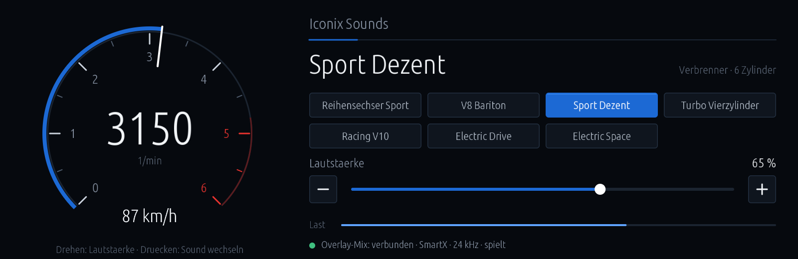
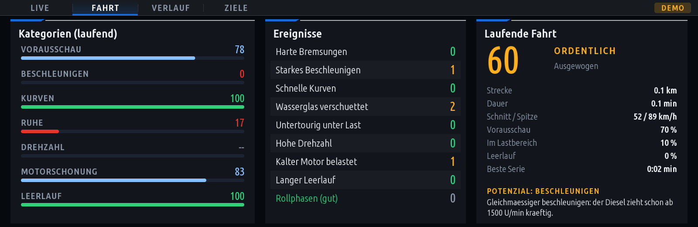
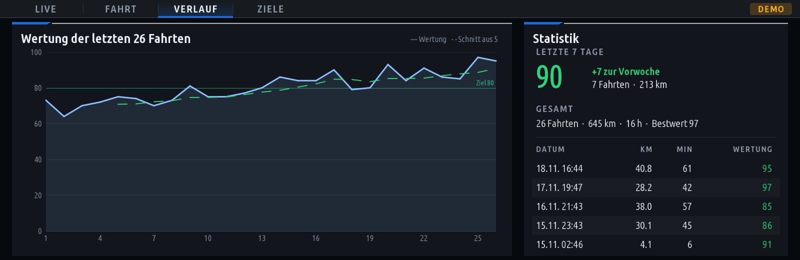

<h1 align="center">Iconix Sounds</h1>

<p align="center">
  <b>Virtueller Motorsound für BMW mit iDrive 7 (MGU) – über die eigenen Lautsprecher, gesteuert von
  echter Drehzahl und Last.</b><br>
  Entwickelt und im Alltag gefahren in einem BMW 220d (G42). Installierbar über den MGU Store.
</p>

<p align="center">
  
  
  
  
</p>

<p align="center">
  
</p>

> **Hinweis.** Inoffizielles Hobbyprojekt, nicht von der BMW AG unterstützt oder mit ihr verbunden.
> Änderungen am eigenen Head Unit erfolgen auf eigenes Risiko. Lautstärke vernünftig wählen, damit
> Warn- und Umgebungsgeräusche hörbar bleiben.

---

## Was Iconix Sounds macht

Iconix Sounds erzeugt live einen Motorsound und spielt ihn über die Fahrzeuglautsprecher ab – ähnlich
wie BMWs eigenes „Active Sound Design“, aber mit wählbarem Charakter. Grundlage sind die echten
Fahrzeugdaten: Drehzahl, Motormoment (Last) und Geschwindigkeit. Gibst du Gas, wird der Sound voller;
beim Gleiten bleibt er dezent im Hintergrund, im Schub blubbert er leise aus.

- **Klingt wie im Innenraum, nicht wie ein Synthesizer.** Jeder Zylinder erzeugt pro Zündung einen
  Abgas-Druckimpuls (echte Zündfolge), der durch eine nachgebildete Auspuffanlage läuft: Krümmer,
  Hauptrohr, Schalldämpfer. Dazu kommt Körperschall über Motorlager und Karosserie. Die Karosserie
  dämpft die Höhen – so wie man einen Motor im Auto wirklich hört.
- **Keine schrillen Töne, keine Knackser, kein Rauschen.** Kein Turbo-Pfeifen, keine Patscher, kein
  Ansaugrauschen; nichts oberhalb von etwa 2 kHz. Prüfwerkzeuge im Repository messen das automatisch.
- **Läuft im Hintergrund,** auch wenn die App nicht geöffnet ist, und schont das Head Unit
  (Klangberechnung direkt in 24 kHz, wenige Millisekunden Rechenzeit pro Sekunde Ton).

### Die Profile

| Profil | Charakter |
|---|---|
| **Sport Dezent** (Standard) | Gedämpfter Reihensechser mit Serienauspuff – leise beim Gleiten, sonor unter Last. Für den 220d gedacht: klingt bewusst nicht nach Diesel. |
| **Reihensechser Sport** | Seidiger Sechszylinder mit Sportauspuff, dicht und voll unter Last. |
| **V8 Bariton** | Cross-Plane-V8 mit dem typischen ungleichmäßigen Blubbern. |
| **Turbo Vierzylinder** | Kernig und drehfreudig. |
| **Racing V10** | Voller, dichter Zehnzylinder mit begrenztem Drehzahlband. |
| **Electric Drive** | Ruhiger, tiefer E-Antriebston, steigt mit der Geschwindigkeit. |
| **Electric Space** | Schwebender, sphärischer E-Sound. |

**Hörproben** (so, wie sie im Auto ankommen: 24 kHz mono; Leerlauf, Vollgas bis 4800 U/min, Schub,
Konstantfahrt, Teillast):
[Sport Dezent](docs/audio/iconix_sport_dezent.wav) ·
[Reihensechser Sport](docs/audio/iconix_reihensechser.wav) ·
[V8 Bariton](docs/audio/iconix_v8.wav)

### Bedienung und Einstellungen

- Profil per Antippen oder iDrive-Controller wählen (drehen = Lautstärke, drücken = nächster Sound)
- Lautstärke, **Ausprägung** (wie stark der Sound mit der Last aufmacht), Sport-Boost, stumm im Stand
- Leerlauf- und Abregeldrehzahl sowie maximales Drehmoment des eigenen Motors – der Sound bildet das
  echte Drehzahlband auf das Profil ab
- **Testsound:** 9 Sekunden Leerlauf → Vollgas → Schub, auch im Stand
- **Audio-Diagnose** direkt in der App: Verbindung zum Audiomanager, Quellen, Senken, SmartX-Kanäle

### So kommt der Ton in die Lautsprecher

Store-Apps haben keine Audio-Schnittstelle. Deshalb erzeugt das Tool **Iconix Audio** (ein kleiner
Dienst auf dem Head Unit) den Sound und schreibt ihn in einen Audiokanal des BMW-Systems (SmartX). Die
App bittet den BMW-Audiomanager, diesen Kanal mit den Lautsprechern zu verbinden – nur solange Ton
gebraucht wird.

Der **Tonweg** ist in den Einstellungen wählbar. Standard ist der **Overlay-Mix**: Der Motorsound
liegt über der Musik, die weiterläuft. Weitere Wege (CarLife exklusiv, CarLife-Navi, MainSink,
CarPlay-Kanal, ALSA direkt) sind zum Ausprobieren in anderen Autos und Ausstattungen gedacht.

---

## Installation

Voraussetzung ist ein iDrive 7 (MGU) mit Root-Zugang und installiertem
[MGU Store](https://github.com/robertnisipeanu/mgu-store).

1. Im MGU Store dieses Repository als Quelle hinzufügen: `Nico1003/idrive7-apps`
2. **Iconix Sounds** installieren. Das Tool **Iconix Audio** kommt als Abhängigkeit automatisch mit.
3. App öffnen, **Testsound** drücken – fertig. Updates kommen über den Store.

Klappt es nicht auf Anhieb: In der Statuszeile sollte „Overlay-Mix: verbunden“ stehen. Wenn nicht,
**Audio-Diagnose** öffnen, ein Foto machen, den nächsten **Tonweg** probieren und gern ein
[Issue](https://github.com/Nico1003/idrive7-apps/issues) mit dem Foto anlegen.

| Komponente | Version |
|---|---|
| Iconix Sounds (App) | 0.9.2 |
| Iconix Audio (Tool) | 0.9.2 |

---

## Außerdem: Fahrstil-Coach

<p align="center">
  
</p>

Die zweite App in diesem Repository (Version 1.0.2) bewertet jede Fahrt live und im Rückblick, ähnlich
einem Fahrlehrer auf dem Beifahrersitz:

- **Wertung von 0 bis 100** aus sieben Kategorien: Vorausschau, Beschleunigen, Kurven, Ruhe,
  Drehzahl, Motorschonung und Leerlauf
- **Wasserglas,** das mit den echten Längs- und Querkräften schwappt und bei ruppiger Fahrweise
  verschüttet
- **Live-Tipps** (kalter Motor, Drehzahl, Turbo abkühlen lassen), **Verlauf** mit Wochenvergleich,
  **Level und 15 Abzeichen**
- Coach-Modus Eco, Ausgewogen oder Sportlich – „Auto“ folgt dem Fahrerlebnisschalter
- Läuft im Hintergrund und erkennt Fahrtbeginn und -ende selbst

<table>
  <tr>
    <td></td>
    <td></td>
  </tr>
  <tr>
    <td align="center"><sub>Fahrt: Kategorien, Ereignisse, Kennzahlen</sub></td>
    <td align="center"><sub>Verlauf: Wertung der letzten Fahrten</sub></td>
  </tr>
</table>

---

## Für Entwickler

| Pfad | Inhalt |
|---|---|
| `apps/iconix_sounds/` | Iconix Sounds: `main.js`, `ui.js`, `car_route.js` (Audiomanager), `synth.js` + `profiles.js` (Klang) |
| `tools/iconix-audiod/` | Audio-Dienst: Synthese und Ausgabe über SmartX/ALSA (`engine.js`, `alsa_play.py`) |
| `apps/drive_coach/` | Fahrstil-Coach: `coach.js` (Bewertung), `goals.js` (Level, Abzeichen), `main.js` |
| `kit/runtime/` | Laufzeit des Kits (Bildschirm, Signale, Einstellungen), wird in jede App gepackt |
| `kit/tools/` | `build.py` (baut die App auf dem Head Unit), Tests und Klang-Werkzeuge |
| `mgu-repo.json` | was der MGU Store aus diesem Repository anbietet |

Alles läuft mit Node, ohne Auto:

```bash
node kit/tools/test_iconix_route.js
```

```bash
node kit/tools/iconix_calibrate.js --wav docs/sounds --rate 24000
```

```bash
node kit/tools/iconix_popscan.js
```

```bash
node kit/tools/test_drive_coach.js
```

`test_iconix_route.js` prüft Tonweg, Umrechnung und Klang (keine Höhen, keine Knackser, kaum
Rauschen); `iconix_calibrate.js` misst Pegel und Klangbild je Profil und schreibt Hörproben;
`iconix_popscan.js` sucht in einer Fahrt mit Schaltvorgängen nach Knacksern.

Der Klang folgt dem physikalisch informierten Ansatz von Baldan et al. (2015, „Physically informed car
engine sound synthesis“) und den offenen Projekten
[engine-sound-lab](https://github.com/geoffmyers/engine-sound-lab) und
[ice-engine-simulator](https://github.com/daveruiz/ice-engine-simulator) (Ideen und Größenordnungen,
kein übernommener Code).

Die Apps basieren auf dem Kit aus
[cauliflowermossgrape/idrive7-apps](https://github.com/cauliflowermossgrape/idrive7-apps); dieses
Repository enthält nur den Teil, den die beiden Apps brauchen. Doku zum Kit:
[Originalprojekt](https://github.com/cauliflowermossgrape/idrive7-apps#readme) (englisch).

---

## Danksagung

- [cauliflowermossgrape/idrive7-apps](https://github.com/cauliflowermossgrape/idrive7-apps):
  Kit, Laufzeit und Build
- [Robert Nisipeanu / MGU Store](https://github.com/robertnisipeanu/mgu-store): Store und Renderer
- Der Audiomanager-Weg folgt dem, was Moonride (JustAnotherPU),
  [M850i-amn/idrive7-apps](https://github.com/M850i-amn/idrive7-apps) und
  [loenne007/idrive-enginesound](https://github.com/loenne007/idrive-enginesound) dokumentiert haben

## Lizenz

[MIT](LICENSE), wie das Kit des Originalprojekts.
