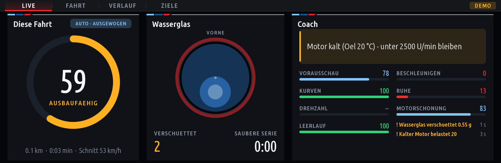

<h1 align="center">iDrive 7 Apps</h1>

<p align="center">
  <b>Eigene Apps für das BMW-Infotainment iDrive 7 (MGU), installierbar über den MGU Store.</b><br>
  Entwickelt und im Alltag gefahren in einem BMW 220d (G42).
</p>

<p align="center">
  
  
  
</p>

<p align="center">
  
</p>

> **Hinweis.** Inoffizielles Hobbyprojekt, nicht von der BMW AG unterstützt oder mit ihr verbunden.
> Änderungen am eigenen Head Unit erfolgen auf eigenes Risiko. Die Apps nur so bedienen, dass der
> Blick auf der Straße bleibt.

---

## Die Apps

| App | Version | Stand |
|---|---|---|
| [**Fahrstil-Coach**](#fahrstil-coach) | 1.0.1 | läuft |
| [**Iconix Sounds**](#iconix-sounds) | 0.6.0 | experimentell, Ton im Auto noch nicht bestätigt |
| **Iconix Audio** (Tool) | 0.6.0 | Audio-Dienst für Iconix Sounds, wird automatisch mitinstalliert |

### Fahrstil-Coach

Bewertet jede Fahrt live und im Rückblick, ähnlich einem Fahrlehrer auf dem Beifahrersitz.

- **Wertung von 0 bis 100** aus sieben Kategorien: Vorausschau (Bremsen), Beschleunigen, Kurven,
  Ruhe (Ruck), Drehzahl, Motorschonung und Leerlauf
- **Wasserglas:** Ein virtuelles Glas schwappt mit den echten Längs- und Querkräften und verschüttet
  bei ruppiger Fahrweise
- **Live-Tipps,** z. B. bei kaltem Motor, zu niedriger oder zu hoher Drehzahl oder zum Abkühlen des
  Turbos vor dem Abstellen
- **Coach-Modus** Eco, Ausgewogen oder Sportlich; „Auto“ folgt dem Fahrerlebnisschalter
- **Verlauf** der letzten Fahrten mit Schnitt, Zielwert und Vergleich zur Vorwoche
- **Level und 15 Abzeichen,** von „Erste Fahrt“ bis „Perfektionist“
- Erkennt Fahrtbeginn und -ende selbst und läuft im Hintergrund, auch ohne geöffnete App
- Einstellbar für Diesel oder Benziner, mit eigener Kaltlauf-Grenze und eigenem Drehmoment

<table>
  <tr>
    <td></td>
    <td></td>
  </tr>
  <tr>
    <td align="center"><sub>Fahrt: Kategorien, Ereignisse, Kennzahlen</sub></td>
    <td align="center"><sub>Verlauf: Wertung der letzten Fahrten</sub></td>
  </tr>
</table>

### Iconix Sounds

Virtueller Motor- oder Elektrosound über die Fahrzeuglautsprecher, gesteuert von echter Drehzahl,
Last und Geschwindigkeit.

- **Sieben Profile:** Reihensechser Sport, V8 Bariton, Sport Dezent, Turbo Vierzylinder,
  Racing V10, Electric Drive und Electric Space
- Lautstärke, Ausprägung, Sport-Boost, Pops & Bangs im Schub, stumm im Stand
- Bedienung per Touch oder iDrive-Controller (drehen = Lautstärke, drücken = nächster Sound)
- **Tonweg wählbar:** Die App bittet den BMW-Audiomanager um einen Lautsprecherkanal. Weil noch
  nicht feststeht, welcher Weg in welchem Auto funktioniert, lassen sich sieben Varianten
  nacheinander testen (Overlay-Mix über der Musik, CarLife exklusiv, CarLife-Navi, MainSink,
  CarPlay-Kanal, ALSA direkt)
- **Audio-Diagnose** direkt in der App: Verbindungen, Quellen und Senken des Audiomanagers,
  SmartX-Kanäle und ALSA-Geräte

<p align="center">
  
</p>

> **Experimentell.** Den Ton erzeugt das Tool *Iconix Audio* als Dienst auf dem Head Unit. Ob er
> im Auto hörbar ist, ist noch nicht bestätigt. Erst im Stand und mit niedriger Lautstärke testen.

---

## Installation

Voraussetzung ist ein iDrive 7 (MGU) mit Root-Zugang und installiertem
[MGU Store](https://github.com/robertnisipeanu/mgu-store).

1. Im MGU Store dieses Repository als Quelle hinzufügen: `Nico1003/idrive7-apps`
2. **Fahrstil-Coach** und/oder **Iconix Sounds** installieren. Iconix Sounds bringt das Tool
   **Iconix Audio** als Abhängigkeit mit.
3. Updates kommen über den Store; jede Änderung hat eine neue Versionsnummer.

Deinstallieren geht ebenfalls über den Store.

### Iconix Sounds im Auto testen

1. In den Einstellungen der App den **Tonweg** auf `1 Overlay-Mix` stellen und **Testsound** drücken.
   In der Statuszeile sollte „Overlay-Mix: verbunden“ stehen.
2. Bleibt es still: **Audio-Diagnose** öffnen, ein Foto machen und den nächsten Tonweg probieren.
3. Die Fotos der Diagnose zeigen, welche Quellen und Kanäle dein Auto hat. Gern als
   [Issue](https://github.com/Nico1003/idrive7-apps/issues) melden.

---

## Für Entwickler

Die Apps basieren auf dem Kit aus
[cauliflowermossgrape/idrive7-apps](https://github.com/cauliflowermossgrape/idrive7-apps). Wie es
funktioniert (App-Format, Fahrzeugsignale, Build, Emulator) steht in der
**[Kit-Dokumentation](docs/kit.md)** (englisch).

| Pfad | Inhalt |
|---|---|
| `apps/drive_coach/` | Fahrstil-Coach: `coach.js` (Bewertung), `goals.js` (Level, Abzeichen), `main.js` (Bildschirm) |
| `apps/iconix_sounds/` | Iconix Sounds: `car_route.js` (Audiomanager), `synth.js` (Klang), `main.js`, `ui.js` |
| `tools/iconix-audiod/` | Audio-Dienst: Synthese und Ausgabe über SmartX/ALSA (`alsa_play.py`) |
| `kit/` | Laufzeit, Build-Werkzeuge und Tests aus dem Kit |
| `mgu-repo.json` | was der MGU Store aus diesem Repository anbietet |

Tests laufen mit Node ohne Auto:

```bash
node kit/tools/test_drive_coach.js
```

```bash
node kit/tools/test_iconix_route.js
```

Die weiteren Apps im Ordner `apps/` stammen aus dem Originalprojekt und werden über diesen Store
nicht angeboten (`exclude` in `mgu-repo.json`).

---

## Danksagung

- [cauliflowermossgrape/idrive7-apps](https://github.com/cauliflowermossgrape/idrive7-apps):
  Kit, Laufzeit und Build, auf denen diese Apps aufbauen
- [Robert Nisipeanu / MGU Store](https://github.com/robertnisipeanu/mgu-store): Store und Renderer
- Der Audiomanager-Weg für Iconix Sounds folgt dem, was Moonride (JustAnotherPU),
  [M850i-amn/idrive7-apps](https://github.com/M850i-amn/idrive7-apps) und
  [loenne007/idrive-enginesound](https://github.com/loenne007/idrive-enginesound) dokumentiert haben

## Lizenz

[MIT](LICENSE). Hinweise zu Drittanbieter-Code stehen in [`third_party/`](third_party) und in der
[Kit-Dokumentation](docs/kit.md#doom-and-renderer-licences).
